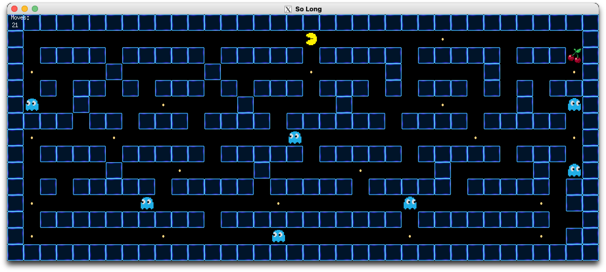

# so_long



Projet réalisé dans le cadre du cursus de l'école 42.

## Présentation

**so_long** est un petit jeu 2D développé en C avec la MiniLibX. Le joueur
doit parcourir une carte, récupérer tous les collectibles, puis atteindre la
sortie sans traverser les murs.

Le projet met en pratique :

- la création d'une fenêtre graphique avec la MiniLibX ;
- la gestion des événements clavier et de la fermeture de la fenêtre ;
- le parsing et la validation de cartes au format `.ber` ;
- la vérification de l'accessibilité de la carte par flood fill ;
- la gestion des collisions, des déplacements et des ressources.

La version bonus ajoute notamment des animations, des fantômes, le compteur de
mouvements et le mode Super Pacman.

## Prérequis

- macOS ;
- `clang` ou `cc` ;
- `make` ;
- Homebrew ;
- XQuartz, nécessaire pour utiliser la MiniLibX Linux sur macOS.

### Installer XQuartz

```bash
brew install --cask xquartz
```

Après l'installation, redémarre la session macOS. Si nécessaire, ouvre
également **XQuartz** depuis `Applications > Utilitaires`, puis vérifie que
ses fichiers sont disponibles :

```bash
ls /opt/X11/include/X11/Xlib.h
```

## Compilation

Depuis la racine du projet :

```bash
make
```

Pour compiler la version bonus :

```bash
make bonus
```

Pour supprimer les fichiers compilés :

```bash
make clean
```

Pour supprimer les fichiers compilés, les bibliothèques et les exécutables :

```bash
make fclean
```

## Lancement

Le programme doit recevoir une carte `.ber` en argument :

```bash
./so_long maps/valid_map/map1.ber
```

Version bonus :

```bash
./so_long_bonus maps/valid_map/map1.ber
```

Des cartes d'exemple sont disponibles dans :

```text
maps/valid_map/
maps/invalid_map/
```

## Contrôles

| Action | Touches |
| --- | --- |
| Déplacer vers le haut | `W` ou flèche haut |
| Déplacer vers le bas | `S` ou flèche bas |
| Déplacer vers la gauche | `A` ou flèche gauche |
| Déplacer vers la droite | `D` ou flèche droite |
| Quitter | `Échap` ou fermer la fenêtre |

## Format d'une carte

Chaque carte doit :

- avoir l'extension `.ber` ;
- être rectangulaire ;
- être entourée de murs ;
- contenir exactement un joueur, une sortie et au moins un collectible ;
- permettre au joueur d'atteindre tous les collectibles et la sortie.

| Symbole | Signification |
| --- | --- |
| `1` | Mur |
| `0` | Sol |
| `P` | Position initiale du joueur |
| `C` | Collectible |
| `E` | Sortie |

Exemple :

```text
111111111
1000C0001
101111101
1P0000E01
111111111
```

## Arborescence

```text
.
├── includes/          # Fichiers d'en-tête
├── maps/              # Cartes de jeu
├── minilibx-linux/    # MiniLibX utilisée avec XQuartz
├── srcs/              # Version obligatoire
├── srcs_bonus/        # Version bonus
└── textures/          # Textures et sprites
```

## Licence

Projet pédagogique réalisé dans le cadre de l'école 42.
